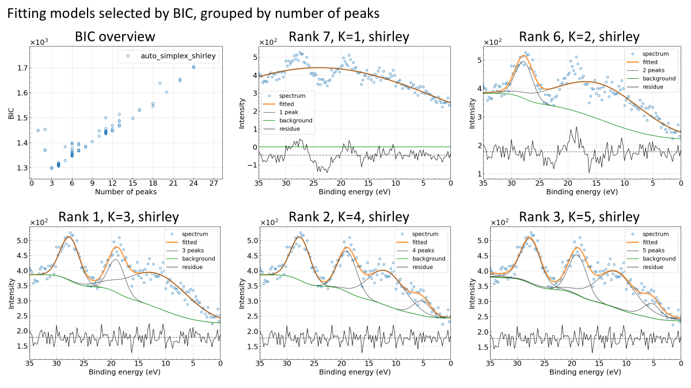

# xps-bic-fitting-cv
BIC based fitting of XPS spectra using convolution‑Voigt basis functions

## 概要
これはXPSのナロースペクトルのピーク分離ツールです。
与えられたナロースペクトルについて、さまざまなピーク本数から成る最大155通りの初期値を元に擬似Voigt関数を基底関数としてピークフィッティングを実行し，その結果をベイズ情報量規準(Bayesian information criterion, BIC)で評価して上位の解のパターンを出力します．

以下に示す6枚の図のうち，左上の図はフィッティングの解を構成するピーク本数 K に対するBICの値です．BICはフィッティングの良さとモデルの複雑さをバランスよく評価する指標で，BICの小さい解はピーク数が少なくかつフィッティングが良好なものとなります．その他の図は解の候補で，BICの小さい順にランクの値を付け，ピーク本数 K の値とともに示されます．図中の shirley は Shirley のバックグラウンドを用いることを示します．



## 開発環境
- Ubuntu 22.04 LTS
- gcc 11.4.0
- Python 3.12.10
  - numpy, matplotlib, pandas, python-pptx
- LAPACK, BLAS, OpenMP, GSL, libcerf

## 環境構築と実行手順

### 環境構築
```bash
sudo apt update && sudo apt install -y liblapack-dev libgomp1 libgsl-dev libcerf-dev
make -C src -j
uv venv
source .venv/bin/activate
uv sync
```

### 実行手順
```bash
cd sample
bash ../src/exec_single.sh PVMK_VB_half.csv
```

## 入力データ
- XPSスペクトルデータ

### XPSスペクトルデータの書式
XPSスペクトルデータはヘッダなし2列のCSV形式であること．
第1列はeV単位の結合エネルギーで降順に並んでいること．
第2列はスペクトルの強度で0以上の正の実数値であること．

例(`PVMK_VB_half.csv`)：
```
35.0,409.0
34.75,401.0
34.5,394.0
34.25,358.0
34.0,369.0
・・・
```

## 計算結果
プログラムを実行した結果，スペクトルデータ`PVMK_VB_half.csv`のファイル名に基づいて`PVMK_VB_half`フォルダが作られ，その中に解析結果が格納される．
本ツールはさまざまなピーク本数から成る最大155通りのピークフィッティングを実行する．その後以下の条件でフィルタリングを行い，抽出されたフィッティングモデルをファイル出力する．<br>
- XPSの分解能を考慮して，すべてのピークの半値半幅が0.1eVより大きいモデルのみ抽出する．<br>
- 一つのピーク本数について複数のフィッティングモデルがある場合は，その中で最もBIC値の小さいモデルを一つ選ぶ．<br>
- それらのフィッティング結果をBIC値の小さい順にランク付けする．<br>
- BIC値の上位5件のピーク本数を調べ，それらよりもピーク本数が多いモデルは複雑さの度合いが大きすぎるため除外する．<br>

デフォルトではShirleyバックグラウンドを仮定した結果が採用される．Shirleyバックグラウンドのモデルが見つからなかった場合には直線バックグラウンドの結果が採用される．<br>

### 計算結果の一覧
出力フォルダ`PVMK_VB_half`の内容は次の通り
```
PVMK_VB_half
├── BIC_vs_NumPeak.png
├── PVMK_VB_half.csv
├── gbp_rank1_numPeak3_auto_shirley_parameters.csv
├── gbp_rank1_numPeak3_auto_shirley_result.csv
├── gbp_rank1_numPeak3_auto_shirley_result.png
├── gbp_rank2_numPeak4_auto_shirley_parameters.csv
├── gbp_rank2_numPeak4_auto_shirley_result.csv
├── gbp_rank2_numPeak4_auto_shirley_result.png
├── gbp_rank3_numPeak5_auto_shirley_parameters.csv
├── gbp_rank3_numPeak5_auto_shirley_result.csv
├── gbp_rank3_numPeak5_auto_shirley_result.png
├── gbp_rank4_numPeak6_auto_shirley_parameters.csv
├── gbp_rank4_numPeak6_auto_shirley_result.csv
├── gbp_rank4_numPeak6_auto_shirley_result.png
├── gbp_rank5_numPeak7_auto_shirley_parameters.csv
├── gbp_rank5_numPeak7_auto_shirley_result.csv
├── gbp_rank5_numPeak7_auto_shirley_result.png
├── gbp_rank6_numPeak2_auto_shirley_parameters.csv
├── gbp_rank6_numPeak2_auto_shirley_result.csv
├── gbp_rank6_numPeak2_auto_shirley_result.png
├── gbp_rank7_numPeak1_auto_shirley_parameters.csv
├── gbp_rank7_numPeak1_auto_shirley_result.csv
├── gbp_rank7_numPeak1_auto_shirley_result.png
├── input_spectrum2.png
├── result_figures.pptx
├── stderr
├── stdout
└── summary_BIC.csv
```

- パワーポイントファイル
  - `result_figures.pptx`: まとめスライド．BIC vs. ピーク本数の図およびフィッティング結果の図の一覧
- 画像ファイル
  - `BIC_vs_NumPeak.png`: BIC vs. ピーク本数の図
  - `gbp_rank(*1)_numpeak(*2)_(*3)_(*4)_result.png`: フィッティング結果の図．
    (*1)～(*4)の意味は次の通り．
    - (*1) BIC値に基づくランク
    - (*2) ピーク本数
    - (*3) 最適化ステージ名．autoまたはparam
    - (*4) バックグラウンドモデルの種類．shirleyまたはlinear
  - `input_spectrum2.png`: 入力スペクトルの図
- 数値データファイル
  - `summary_BIC.csv`: ピーク本数とBICの数値データ
  - `gbp_rank(*1)_numpeak(*2)_(*3)_(*4)_parameters.csv`: フィッティングパラメータの数値データ
  - `gbp_rank(*1)_numpeak(*2)_(*3)_(*4)_result.csv`: フィッティング結果を描画するための数値データ
- ログファイル
  - `stdout`: `peakSeparationForXPS.py` の標準出力．
  - `stderr`: `peakSeparationForXPS.py` の標準エラー．


## 出力データの書式

- `summary_BIC.csv`: ピーク本数とBICの数値データ．例：
    ```
    numPeak,bic_gauss,method,auto_ID,param_ID
    3,1299.0642567708337,auto_shirley,1888,
    3,1299.0716001534422,auto_shirley,1600,
    3,1299.0742390756698,auto_shirley,1536,
    3,1299.0790253167445,auto_shirley,1440,
    3,1299.0810317754922,auto_shirley,2112,
    ・・・
    ```

各列の意味は次の通り．

  | Label                 | Description                                                                |
  | --------------------- | -------------------------------------------------------------------------- |
  | numPeak               | ピーク本数                                                                 |
  | bic_gauss/bic_poisson | BIC値                                                                      |
  | method                | 最適化ステージ名(auto/param)とバックグラウンドモデルの種類(shirley/linear) |
  | auto_ID               | 最適化ステップ "auto" の初期モデルごとに与えられるID                       |
  | param_ID              | 最適化ステップ "param" の初期モデルごとに与えられるID                      |


- `gbp_rank(*1)_numpeak(*2)_(*3)_(*4)_parameters.csv`: フィッティングパラメータの数値データ．例：
    ```
    peakID,height,position,sigma,gamma,area
    0,1.43131e+02,27.565,1.760,0.000,6.31348e+02
    1,1.09026e+02,19.028,1.505,0.000,4.11171e+02
    2,1.14301e+02,11.153,5.632,0.000,1.61386e+03
    ```

各列の意味は次の通り．

  | Label    | Description               |
  | -------- | ------------------------- |
  | peakID   | ピークのID．開始は0．     |
  | height   | ピークの高さ (arb. units) |
  | position | ピーク位置 (eV)           |
  | sigma    | ピークのガウス幅 (eV)     |
  | gamma    | ピークのローレンツ幅 (eV) |
  | area     | ピーク面積                |

- `gbp_rank(*1)_numpeak(*2)_(*3)_(*4)_result.csv`: フィッティング結果を描画するための数値データ．例：
    ```
    Binding_Energy(eV),spectrum,background,sum_peaks,fitting,peak[0],peak[1],peak[2]
    35,409,386.09,0.034378,386.124,386.109,386.09,386.105
    34.75,401,386.089,0.0527093,386.142,386.124,386.089,386.107
    34.5,394,386.088,0.0826791,386.171,386.149,386.088,386.11
    34.25,358,386.086,0.131428,386.218,386.192,386.086,386.112
    34,369,386.084,0.209913,386.294,386.262,386.084,386.115
    ・・・
    ```

各列の意味は次の通り．

  | Label              | Description                                              |
  | ------------------ | -------------------------------------------------------- |
  | Binding_Energy(eV) | 結合エネルギー (eV)                                      |
  | spectrum           | 入力スペクトルデータ (arb. units)                        |
  | background         | 最適化モデルのバックグラウンド(BG)                       |
  | sum_peaks          | 最適化モデルの全ピークを足し合わせたデータ．BGは含まない |
  | fitting            | 最適化モデルの全ピーク＋BGのスペクトルデータ             |
  | peak[#]            | #番目のピークIDに対応するピーク+BGのスペクトルデータ     |


## プログラムパッケージ
```
src/
├── auto_simplex/*
├── ga/*
├── param_simplex/*
├── exec_single.sh
├── flow.py
├── make_result_figures_ppt2.py
├── makefile
├── peakSeparationForXPS.py
├── recipe.txt
└── settings.inp
```

- exec_single.sh: メインの実行スクリプト
- peakSeparationForXPS.py: recipe.txtに基づいてプログラムの実行モードを設定
- flow.py: 処理の流れを制御
- auto_simplexフォルダ: 最適化の第1ステップ用のプログラム群
- gaフォルダ: 最適化の第2ステップ用のプログラム群
- param_simplexフォルダ: 最適化の第3ステップ用のプログラム群
- plot_result_shirley_and_linear.py: 結果をBICに基づいてランク付けし，図を作成する．
- myfunc.py: 関数群
- make_result_figures_ppt2.py: まとめスライドを作成
- settings_Shirley.inp: Shirleyバックグラウンド用の設定ファイル
- settings_Linear.inp: 直線バックグラウンド用の設定ファイル
- recipe.txt: 設定ファイル。


### 設定ファイル `settings.inp`
設定ファイル `settings.inp` によりプログラムの動作を調整することができ，ピークの半値全幅の最小値とx軸ラベルを変えることができる．
- ピークの半値全幅の最小値を調整するときは次のように記述する：
  `minimumPeakFWHM     0.2` 
  数値の単位は入力データのx軸の数値の単位と揃えること．スペクトルの種類によって適切なピークの幅の最小値を与えること．
- フィッティングの図のx軸ラベルを調整するときは次のように記述する：
  `plot_xlabel     Binding_energy_(eV)`

#### XPSスペクトルの解析の場合
空の設定ファイル `settings.inp` をそのまま使用する．
この場合，ピークの半値全幅の最小値は `0.2` eV，x軸ラベルは `Binding_energy_(eV)` となる．

#### X線スペクトルの解析の場合
例としてピークの半値全幅の最小値を `2.2` eV に，x軸ラベルを `Energy_(eV)` に変更する場合は次のように記述する．
- settings.inp
  ```
  minimumPeakFWHM              2.2
  plot_xlabel                  Energy_(eV)
  ```

### 設定ファイル `recipe.txt`
作業フォルダ，すなわち入力ファイルと同じ階層のフォルダに設定ファイル `recipe.txt` を置くことによりプログラムの実行モードの設定ができる．
このファイルを置かない場合はデフォルトの設定が使われる．デフォルトでは次のようになっている．

```
bg,auto
noise,gauss
pptx,1
dev,0
optmode,simple
```

| 設定    | 設定の種類             | 値 (*)はデフォルト設定      |
| ------- | ---------------------- | --------------------------- |
| bg      | バックグラウンドモデル | auto (*) / shirley / linear |
| noise   | ノイズの種類           | gauss (*) / poisson         |
| pptx    | まとめスライドの出力   | 0 / 1 (*)                   |
| dev     | 開発者モード           | 0 (*) / 1                   |
| optmode | 最適化処理のモード     | simple (*) / full           |

- 最適化処理のモード
  - `optmode,simple` の場合，最適化処理のステップ1のみを実施する．
  - `optmode,full` の場合，最適化処理のステップ1に続いてステップ2, 3も実施する．
    - ステップ1：スムージング処理を段階的に掛けることにより最大155通りの初期解を用意して，それぞれ最適化を実施する．BICにより解のランク決めをする．
    - ステップ2：ステップ1の結果から推定されるピーク本数をNとして，1からN+3の範囲で，遺伝的アルゴリズムによりピーク本数ごとに解の候補を求める．
    - ステップ3：ステップ2で得た解の候補に対して最適化を実施する．ステップ1で得られた解の候補と合わせて，BICにより解のランク決めをする．
- バックグラウンドモデル
  - `bg,auto` の場合，始めにShirleyバックグラウンドを仮定して最大155通りのピークフィッティングを実行する．Shirleyバックグラウンドのモデルが一つも見つからなかった場合には，引き続いて直線バックグラウンドを仮定して最大155通りのピークフィッティングを実行する．
  - `bg,shirley` の場合，Shirleyバックグラウンドを仮定して最大155通りのピークフィッティングを実行する．
  - `bg,linear` の場合，直線バックグラウンドを仮定して最大155通りのピークフィッティングを実行する．
- ノイズの種類
  - `noise,gauss` の場合，ガウスノイズを仮定した最適化を実行する．スペクトルの強度がcpsなどカウントではない場合に使用する．
  - `noise,poisson` の場合，ポアソンノイズを仮定した最適化を実行する．スペクトルの強度がカウントの場合に使用する．
- まとめスライドの出力
  - `pptx,1` の場合，まとめスライドを作成する．
  - `pptx,0` の場合，まとめスライドを作成しない．
- 開発者モード
  - `dev,0` の場合，中間ファイルを削除する．
  - `dev,1` の場合，中間ファイルをすべて残し，最大155通りのすべてのフィッティング結果やその図を取得できる．このオプションを有効にするとファイルサイズが膨大になることに注意．

## 計算パフォーマンスに関わる設定
- 並列処理の最大数
  - 環境変数`OMP_NUM_THREADS`の数値によりスレッド数を変えることができる．
  - デフォルトでは`exec_single.sh`にて`export OMP_NUM_THREADS=16` と設定しており，16スレッドで処理が行われる．
  - `OMP_NUM_THREADS`の指定がない場合はシングルスレッドで実行される．


## 計算手法
計算手法，特に初期解の生成についての詳細は参考文献[1]を参照のこと．
一方で本プログラムでは基底関数を擬似Voigt関数から畳み込みVoigt関数に変えている．これにより目的関数のパラメータによる偏微分を解析的に表すことができなくなったことに加え，ノイズの種類をガウスノイズだけでなくポアソンノイズにも対応させるため，勾配を必要としない最適化アルゴリズムであるNelder-Meadのシンプレックス法を採用した．

### 生成モデル
XPSのナロースペクトル $f(x)$ を結合エネルギー $x$ の関数として次式で表現する．

$$
\begin{align}
f(x) &= s(x) + b(x), \tag{1} \\
s(x) &= \sum_{k=1}^{K} h_k \tilde{V}(x - \mu_k; \sigma_k, \gamma_k). \tag{2}
\end{align}
$$

$s(x)$ はシグナル関数， $b(x)$ はバックグラウンド関数である． $s(x)$ は $K$ 個のVoigt関数の線形結合で表現され，1つのVoigt関数 $V(x; \mu, h, w, r)$ は次式で定義される．

$$
\begin{align}
\tilde{V}(x; \sigma, \gamma) &= V(x; \sigma, \gamma) / (0; \sigma, \gamma), \tag{3} \\
V(x; \sigma, \gamma) &= \int_{-\infty}^{+\infty} G(x'; \sigma) L(x - x'; \gamma) dx', \tag{4} \\
G(x; \sigma) &= \left( \sigma \sqrt{2} \right)^{-1} \exp \left(-x^2 / 2 \sigma^2 \right), \tag{5} \\
L(x; \gamma) &= \gamma \left( \pi (x^2+\gamma^2) \right)^{-1}, \tag{6} 
\end{align}
$$

$h$ はピークの高さ， $\mu$ はピーク位置， $\sigma$ はピークのガウス幅， $\gamma$ はピークのローレンツ幅である．Shirleyのバックグラウンドの場合，

$$
\begin{align}
b(x) = (b_H - b_L) \frac{\int_{x_L}^{x} s(x') dx'}{\int_{x_L}^{x_H} s(x') dx'} + b_L. \tag{7} \\
\end{align}
$$

ここで $x_L, x_H$ はそれぞれ低結合エネルギー側，高結合エネルギー側の端点の値， $I_L, I_H$ はそれぞれ低結合エネルギー側，高結合エネルギー側のバックグラウンド端点強度である．
直線バックグラウンドの場合は次の通り．

$$
\begin{align}
b(x) =  \frac{I_H - I_L}{x_H - x_L} (x - x_L) + I_L. \tag{8}
\end{align}
$$

### ベイズ情報量規準
数理統計学で用いられるベイズ情報量規準(BIC)を用いてモデル選択を行う．BICは次式で計算される[1]．

$$
\begin{align}
\text{BIC} = -2 \log \hat{L} + m \log N. \tag{9}
\end{align}
$$

$\hat{L}$ は観測されるスペクトルデータ $\{y_i\}_{i=1}^{N}$ とモデル関数 $\{f_i\}_{i=1}^{N}$ のあいだの最大対数尤度， $N$ はスペクトルのデータ数， $m$ はモデル関数に含まれるパラメータ数である．ピーク本数を $K$ として $m = 4 K + 2$ である．観測データに掛かるノイズが一様なガウスノイズであると仮定すると， $\hat{L}$ は次式で計算される．

$$
\begin{align}
-2 \log \hat{L} &= N \left\{ \log(2\pi \hat{\sigma}^2 + 1) \right\}, \tag{10} \\
\hat{\sigma}^2 &= \frac{1}{N} \sum_{i=1}^N \left( y_i - f_i \right)^2. \tag{11}
\end{align}
$$

一方，観測データがカウントでノイズがポアソンノイズの場合には， $\hat{L}$ は次式で計算される．

$$
\begin{align}
\hat{L} = - \log \prod_{i=1}^{N} \frac{f_i^{y_i} e^{-f_i}}{y_i !}
\end{align}
$$


ピーク本数が増えるほど誤差が小さくなり，BICの第1項は小さくなる．一方でピーク本数が増えるとBICの第2項すなわち罰則項は大きくなる．BIC値の小さいモデルは，ピーク数が少なくかつフィッティングが良好なものとなる．

## 諸注意
- 本ツールはXPSのナロースペクトルを解析するためのプログラムであり，ワイドスペクトルの解析には利用できない．
- 本ツールはベイズ情報量規準に基づいて数理的にモデル選択を行う．スピン軌道分裂のような物理的な要請は考慮しない．
- 設定ファイル settings.inp を別途用意する場合，設定ファイルの最終行は必ず改行しておくこと．
- 本資料に記載がある仕様や留意事項に反する利用の仕方をしたことでエラーが発生した場合は，そのエラーの発生原因の究明およびエラー解消への対応は，MDPFでは行いませんのでご注意下さい。


## 参考文献
[1] H. Shinotsuka, H. Yoshikawa, R. Murakami, K. Nakamura, H. Tanaka, K. Yoshihara, Automated information compression of XPS spectrum using information criteria, Journal of Electron Spectroscopy and Related Phenomena. 239 (2020) 146903. https://doi.org/10.1016/j.elspec.2019.146903.


----
最終更新日 2026/09/30
